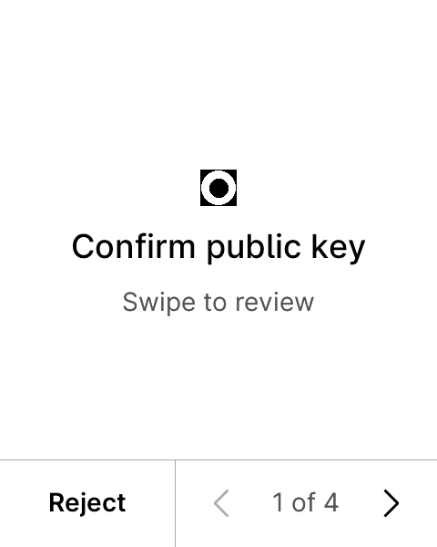
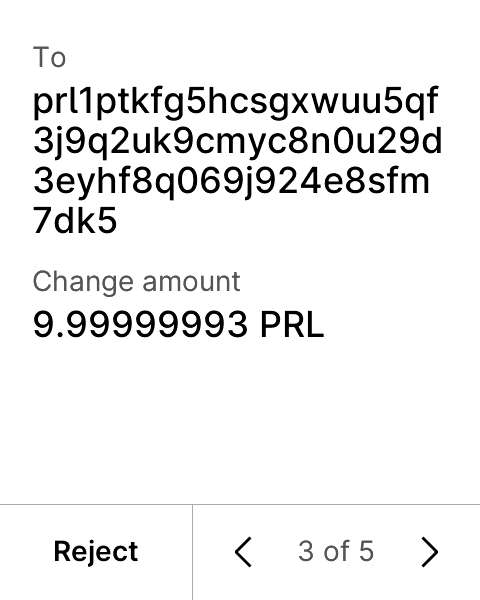
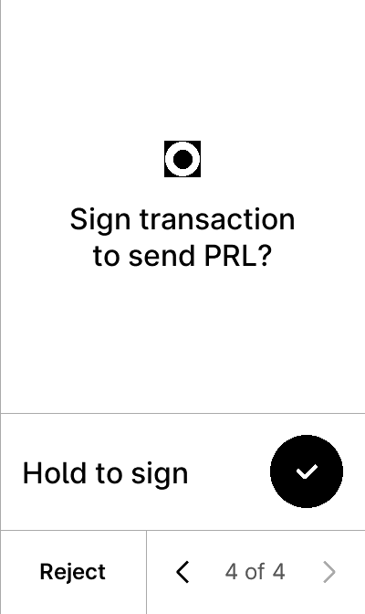
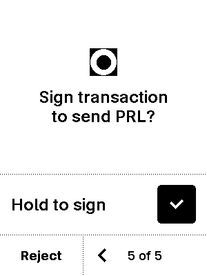

# Ledger model build and screen checks

Checked 2026-10-10, with unchanged Pearl 0.1.0 firmware source. All five current targets build successfully. Fresh Speculos 0.27.1 runs passed account export, Receive approval and two-input P2TR signing on Nano X, Stax, Flex and Nano Gen5; the Nano S Plus already passed those checks on the identical ELF and its fresh ZIP build reproduced that ELF exactly.

| Model | Build target | API / device target ID | ELF bytes | Flash image bytes | Screen implementation | Physical evidence |
| --- | --- | --- | ---: | ---: | --- | --- |
| Nano S Plus | `nanos2` | 27 / `0x33100004` | 236,500 | 67,645 | NBGL, two buttons | Previously recorded OS 1.7.0 installation and owner testing |
| Nano X | `nanox` | 27 / `0x33000004` | 236,496 | 67,645 | NBGL, two buttons | None from this check |
| Stax | `stax` | 27 / `0x33200004` | 242,892 | 90,730 | NBGL touchscreen | None |
| Flex | `flex` | 27 / `0x33300004` | 242,408 | 91,273 | NBGL touchscreen | None |
| Nano Gen5 | `apex_p` | 27 / `0x33400004` | 242,676 | 87,658 | NBGL touchscreen | None |

The original Nano S is not a target. Current firmware disables Bluetooth. [Ledger's official loading guide](https://developers.ledger.com/docs/device-app/beginner/vscode-extension) excludes Nano X from ordinary sideloading; compilation and emulation do not bypass that retail installation gate. Physical rollout/API compatibility, vendor distribution, and radio/USB behavior remain separate from these software checks.

The source declares model-specific icons and uses the pinned SDK's button/touchscreen NBGL implementations. The actual touchscreen review shows the network, account path, recipient, amount, change amount/address/path, and fee before a hold-to-sign action. These are real emulated device screens, not resized browser mockups. The existing host independently verifies the resulting signatures. This is a positive mainnet-format P2TR smoke test, not a complete every-model rejection, stress, P2MR, or all-network qualification matrix.

## Screen examples

These screenshots show a synthetic public test transaction. No real coins were sent. Never fund the documented public fixture seed.

| Flex home | Flex recipient/change review | Stax signing approval | Nano Gen5 signing approval |
| --- | --- | --- | --- |
|  |  |  |  |

The per-model `screens.json` files retain the complete captured account/Receive/signing text and display coordinates. `sign.png` records the final approval page for each newly tested model. Screenshots were visually inspected for representative Flex, Stax and Gen5 review pages; no physical camera or device was involved.

## Reproduction and evidence

`model-matrix.json` records compiled metadata, per-model hashes and sizes, source hashes, test scope and limits. Each new model's `build.json` retains all 167 source-file hashes. The unchanged source-set fingerprint is `92b1d36722c1ea6865bd381966ddb3933a828f5a2313aa34a70a4308362e39f7`.

Builds used SDK `6709cd2bdfebb224ee070f7c1211b54254262579` and immutable official builder `sha256:8d3da9179dd1b241883c769c521ee9403352b60091c80405b5bef5801a003ba2`. Each model had its own temporary source copy at container path `/workspace`, avoiding the SDK's shared output aliases. At most two containers ran concurrently, with two compile jobs each, no network, no USB or Docker socket, read-only root and SDK, dropped capabilities, and no new privileges.

Emulation used the existing `native-pilot.ts` / `emulator.ts` / `speculos-driver.ts` harnesses, Node 24.19.0 and the public vector-one seed, with no firmware patch or automatic-approval flag. Model-specific button/touch gestures drove review. Each successful pilot independently verified two input signatures; no transaction was broadcast. No ELF or HEX has been added to this evidence directory or published.

`build-only.json` describes the separately reproduced Nano S Plus ZIP-build and disposable ledgerblue 0.1.58 environment check. The [installation recipe](../../docs/install-pearl.md) still applies only to its exact Nano S Plus image and recorded OS/API. In particular, do not reuse its loader target ID or installation-parameter size on a different model.
